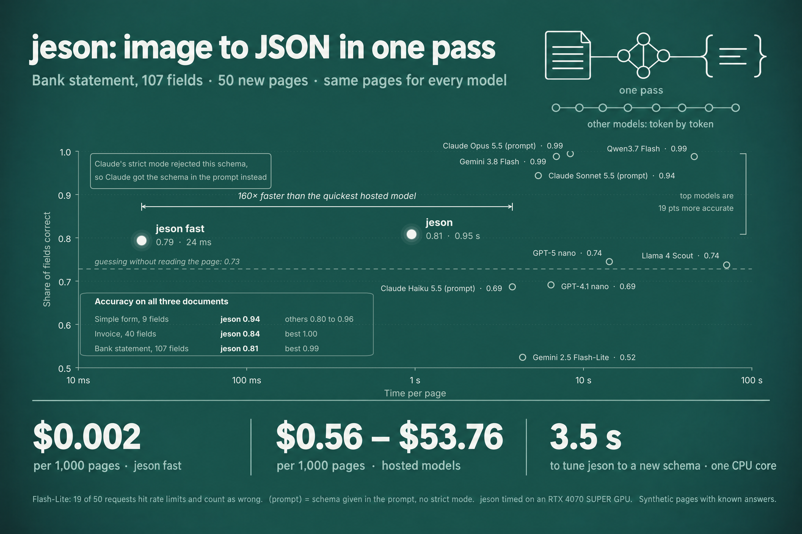

<h1 align="center">jeson</h1>

<p align="center"><b>Typed JSON from images in one forward pass.</b><br>
A JSON Schema and an image in; JSON out that is valid by construction. No token is ever decoded.</p>

<p align="center">
<a href="LICENSE"></a>


</p>

<p align="center"></p>

---

Most fields people extract from documents and screens are not prose. *Is it signed? Which currency? How many line
items? Is the stamp there?* Today they are filled by a language model that **writes** the JSON one token at a time,
so latency and cost grow with the size of the answer, large schemas strain or break strict-output modes, and the
output still has to be parsed.

jeson reads those fields instead of writing them. A vision-language model looks at the image once; then every
allowed value of every field is **scored in parallel** over the cached prefix, and the JSON is assembled in code.
An answer outside the schema cannot occur. For a schema you use every day, a **lock** fits that schema's own heads
on a CPU in seconds from a few hundred labelled images.

```python
from jeson import Reader, Lock

reader = Reader.from_pretrained("Qwen/Qwen3-VL-2B-Instruct")
reading = reader.read("invoice.jpg", schema)      # one prefill + a few packed forwards
reading.json                                      # {"currency": "EUR", "signature_present": true, "line_items_count": 2, ...}
reading.confidence()                              # per field

lock = Lock.fit([reader.read(p, schema) for p in train_pages], train_labels)   # seconds, one CPU thread
reader.extract("next.jpg", schema, lock=lock)
```

## Where it stands

Same 50 synthetic test pages per level, truth known by construction, each hosted model in its own strict
JSON-schema mode. Full tables, settings and caveats: [benchmarks/RESULTS.md](benchmarks/RESULTS.md),
[docs/benchmarks.md](docs/benchmarks.md).

| | L1: 9 fields, flat | L2: 40 fields, 10 line items | L3: 107 fields, 25 transactions |
|---|---|---|---|
| No model (prior) | 0.490 | 0.588 | 0.729 |
| **jeson** Reader + Lock (GPU) | **0.939** · 0.24 s · $0.023/1k | **0.838** · 0.41 s · $0.038/1k | **0.808** · 0.95 s · $0.090/1k |
| **jeson** FastReader (GPU) | 0.754 · 22 ms | 0.832 · 23 ms | 0.794 · 24 ms |
| Claude Haiku 5.5 | 0.945 · 1.5 s · $0.36/1k | 0.999 · 2.4 s · $0.91/1k | strict mode refused the schema |
| Qwen 3.7 Flash | 0.956 · 4.7 s · $0.095/1k | 1.000 · 15 s · $0.28/1k | 0.988 · 45 s · $0.79/1k |
| Gemini 3.8 Flash | | | 0.988 · 6.9 s · $7.60/1k |
| Claude Opus 5.5 | | | 0.994 · 8.3 s · $54/1k (schema in prompt) |

What this says, plainly:

- **Speed and cost.** jeson answers a page in 0.24 s to 0.95 s on one consumer GPU (the FastReader in about
  22 ms), for fractions of a cent per thousand pages. The hosted calls take 1.5 to 70 seconds.
- **Valid by construction, at any size.** Every jeson answer is valid JSON. Claude's strict mode refused the
  107-field schema outright ("compiled grammar is too large").
- **Accuracy: flat schemas yes, repeated sections not yet.** On flat schemas the locked Reader is within a couple of
  points of the fast hosted tier. On pages with repeated sections it trails the best hosted models by 15-19 points,
  and on the 107-field statement it is only 8 points above the no-model prior. The cause is known (it reads the
  page but does not find "row k"), and fixing it is the first item on the [roadmap](docs/roadmap.md).

## Install

```bash
git clone https://github.com/frty2-ai/jeson && cd jeson
pip install -e ".[models]"          # torch + transformers: the Reader and the FastReader
pip install -e .                    # just the compiler, assembler, lock and metrics (no torch)
```

Python 3.10+. The Reader needs a CUDA GPU (a 12 GB card runs the 2B model with 107-field schemas); the FastReader
also runs on a CPU. Model weights download from the Hugging Face Hub on first use.

```bash
python examples/quickstart.py                                   # a synthetic invoice, zero-shot
jeson schema examples/invoice.schema.json                       # what each field compiles to
jeson read examples/invoice.jpg --schema examples/invoice.schema.json --probs
```

## Three ways to read

| | Training | Latency (GPU) | Use it when |
|---|---|---|---|
| `Reader` | none | 0.25-0.95 s a page (5-100 fields) | a new schema, few or no labels, or as the teacher for the others |
| `Reader` + `Lock` | a few hundred labelled images, seconds on a CPU | same as Reader | a schema you run every day: the best accuracy jeson has today |
| `FastReader` | a few hundred labelled images, 5-20 s on a GPU | about 25 ms, flat in the number of fields; 0.8 s on a CPU | throughput, CPU-only deployment, many fields per page |

## How it works

```
JSON Schema ──► compiler ──► typed fields (boolean / choice / ordinal, nullable)
                                   │
image ──► VLM prefill (once) ──► every {"field": value} row scored over the KV cache, packed, in parallel
                                   │                    (4D mask: rows independent of each other and of order)
                                   ▼
                    per-field distributions + hidden state at each field marker
                                   │
                         Lock (optional): one logistic head per field, fitted on a CPU
                                   ▼
                    assembler: most probable allowed value per field ──► JSON, checked against the schema
```

The details (packed rows, multimodal positions, the variance-floored lock, the shared fast head, and the
experimental OCR spans) are in [docs/how-it-works.md](docs/how-it-works.md).

## What a schema can ask

Booleans, enums (choices), ordinals (`"x-ordered": true`, or a small integer range), any of them nullable, nested to
any depth. Strings, numbers and boxes compile but are listed under `"_unanswered"` rather than invented; strings as
verbatim spans of OCR words are experimental. Free text is never answered: it needs generation, and jeson tells you
which keys those are. Reference: [docs/schema.md](docs/schema.md).

## Known limitations

Repeated sections are the main accuracy gap; the benchmark is synthetic (one generator, three templates); the Reader
needs a GPU; int8 CPU serving is not ready; only booleans, choices and ordinals are answered today. All of it, with
numbers: [docs/limitations.md](docs/limitations.md).

## Contributing

jeson is small enough to read in an afternoon, and most of the roadmap is open. Start with
[docs/good-first-issues.md](docs/good-first-issues.md), read [CONTRIBUTING.md](CONTRIBUTING.md), and open an issue
before a large change. Every benchmark claim is reported next to the no-model prior; PRs that move a number are
asked to show both.

## Prior art and acknowledgements

jeson stands on open models: [Qwen3-VL](https://huggingface.co/Qwen/Qwen3-VL-2B-Instruct) (Apache-2.0),
[SigLIP2](https://huggingface.co/google/siglip2-so400m-patch14-384) (Apache-2.0),
[mmBERT](https://huggingface.co/jhu-clsp/mmBERT-base) (MIT), and for the experimental OCR,
[RapidOCR](https://github.com/RapidAI/RapidOCR) with PaddleOCR's PP-OCR models (Apache-2.0). The idea that typed
decisions do not need generation is shared with non-generative decision models such as TypeSafe's Jev and
Convai's Laya for text, and with [GLiNER2](https://github.com/fastino-ai/GLiNER2) for schema-driven extraction from
text. jeson's part is doing it for images against an arbitrary JSON Schema, valid by construction, with a per-schema
lock that fits on a CPU.

## Citation

```bibtex
@software{jeson2026,
  title   = {jeson: typed JSON from images in one forward pass},
  author  = {{The jeson authors}},
  year    = {2026},
  url     = {https://github.com/frty2-ai/jeson},
  license = {Apache-2.0}
}
```

## Licence

Apache License 2.0. See [LICENSE](LICENSE) and [NOTICE](NOTICE). Model weights are downloaded at run time under their
own licences.
